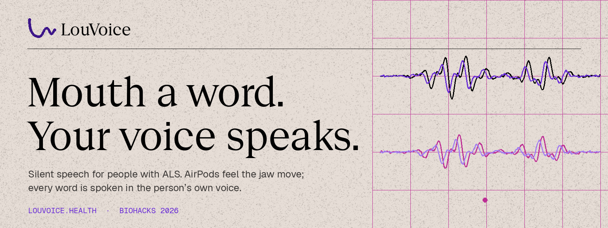
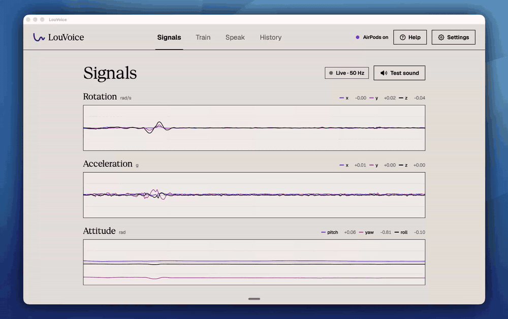

<p align="center">
  <a href="https://louvoice.health"></a>
</p>

<p align="center">
  <a href="https://louvoice.health"><b>louvoice.health</b></a> &nbsp;·&nbsp;
  <a href="#demo">Demo</a> &nbsp;·&nbsp;
  <a href="#results">Results</a> &nbsp;·&nbsp;
  <a href="#built-with-this-weekends-sponsors">Sponsors</a> &nbsp;·&nbsp;
  <a href="#run-it">Run it</a>
</p>

<p align="center">
  
  
  
  
</p>

---

**LouVoice gives people with ALS their own voice back, using AirPods they can already buy.** You mouth a word. The AirPods' motion sensors pick up the tiny movement of your jaw, a model trained on *your* movements recognises the word, and it's spoken aloud in an ElevenLabs clone of *your* voice.

No camera. No microphone for recognition. No implant. No specialist hardware.

<p align="center">
  
  <br><sub>Live AirPods Pro 2 motion in the Signals screen while a word is mouthed.</sub>
</p>

## The problem

- **80–95% of people with ALS** eventually can't meet their daily communication needs with natural speech ([Beukelman et al., 2011](https://pmc.ncbi.nlm.nih.gov/articles/PMC3096454/)).
- **About 95%** of people in the Nebraska ALS Database became unable to speak at some point before death (same source).
- ALS costs **$157,000 a year** per person in Canada; families pay about 78% of the total ([ALS Canada, Burden of ALS Study, 2026](https://www.ctvnews.ca/health/article/the-cost-of-als-in-canada-new-study-reveals-financial-burden-pushing-families-to-the-brink/)).

Today's options are eye-gaze boards, typing, and generic synthetic voices. They're slow, and they don't sound like the person. LouVoice reads the movement that's still there.

## Demo

<!-- TODO: replace with the demo video. On GitHub: edit this file in the browser, drag the .mp4 here, and GitHub inserts a user-attachments link that plays inline. -->
> 🎬 **Demo video coming.** Until then, the GIF above shows live sensor data, and [louvoice.health](https://louvoice.health) shows the product.

## How it works

```
 AirPods Pro 2 ──► head-motion stream ──► jaw-band filter ──► DTW match ──► word ──► ElevenLabs voice clone ──► speaker
  (CoreMotion)     re-seat corrected       trim to motion     vs. your takes          (your voice, cached on the Mac)
```

1. **Enroll (about 10 minutes).** Mouth each word in a few blocks, re-seating the AirPods between blocks so the model learns to handle how they sit.
2. **Recognise.** Banded DTW against every enrolled take (plus augmented copies) picks the nearest word. An explicit *not-a-word* class rejects chewing, swallowing, nods and head turns.
3. **Speak.** The word is spoken in the user's ElevenLabs voice clone. Audio is cached locally, and the API key lives in the macOS Keychain.
4. **Confirm hands-free.** Nod to accept, shake to reject.

Everything runs on the Mac. Nothing leaves it unless the user opts in.

## Results

These are measured on real AirPods data from 754 recorded takes, with held-out evaluation. See [DECISIONS.md](DECISIONS.md) (D46) for the full numbers.

| Test | Result | Chance |
|---|---|---|
| Demo mode: pick the right sentence (2 trained sentences, 45 real takes, each block held out) | **45 / 45** | 50% |
| Isolated words, quiz takes (12 words) | **71%** | 8% |
| Isolated words, whole recording blocks held out (12 words) | **50%** | 8% |

**What this is and isn't.** It's a proof of technology from one user. It isn't open-vocabulary speech yet. The recognizer is personal by design: it learns one person's movements. The next steps are a larger vocabulary, more sessions per user, and testing with people living with ALS.

## Built with this weekend's sponsors

| Sponsor | What we used it for |
|---|---|
| **ElevenLabs** | Voice clone made from the user's own recordings, so every recognised word is spoken in their voice. Audio is cached on the Mac so repeated words play instantly and work offline. |
| **Tiger Data** | TimescaleDB hypertable `word_attempts` plus a continuous aggregate `word_weekly` (7-day buckets, hourly refresh) that powers the caregiver progress chart on the website. It also stores the waitlist, written through a least-privilege `louvoice_web` role. |
| **Vultr** | Cloud compute in New York running the website and its API (Node 22, pm2, Caddy with automatic HTTPS). |
| **GoDaddy Registry** | The `.health` domain: [louvoice.health](https://louvoice.health). |
| **Entire** | Session checkpoints on every Claude Code session, stored as git refs (`refs/entire/checkpoints/*`), so every AI-assisted change is traceable. |

## Run it

Requires macOS 14+ and AirPods Pro connected to the Mac. Command Line Tools are enough; Xcode isn't needed.

```bash
scripts/build-app.sh          # builds and ad-hoc signs build/LouVoice.app
open build/LouVoice.app       # allow Motion when asked
```

Then:
1. **Sensors**: check it's streaming at about 25 Hz.
2. **Enroll**: about 3 minutes (2 blocks), with a re-seat between blocks. Add blocks for more accuracy.
3. **Evaluate**: read the leave-one-block-out and quiz accuracy.
4. **Tune**: change any pipeline variable or run auto-tune on your takes.
5. **Decode**: press Space (or the stem) and mouth a word; nod to accept, shake to reject.

Use the **Simulator** switch at the bottom of the sidebar to try every screen without AirPods. Simulated accuracy means nothing about the real thing.

## Technical deep dive: recognising words with a CNN

### The signal

AirPods Pro have a motion sensor (IMU) in each earbud. macOS exposes it through `CMHeadphoneMotionManager` as **rotation rate** (rad/s, 3 axes), **attitude** (a quaternion), **gravity** and **user acceleration**, at about 50 Hz.

The jaw joint sits just in front of the ear canal. When you mouth a word, the jaw's movement slightly reshapes the canal and the tissue around it, so the earbud seated in it **rocks very slightly**. That rocking is the whole signal:
- **mouthing a word:** peak rotation of about **0.10–0.18 rad/s**;
- **sitting still:** about **0.02 rad/s**;
- **turning your head:** several times larger than a word.

The recogniser has to find a tiny, word-shaped pattern underneath head movement, earbud fit and posture. No audio is involved: the microphone is never opened for recognition.

### From raw motion to features (`Features.swift`)

Each capture (a beep, then about 2 s of motion: a 0.3 s pre-roll plus a 1.8 s window) goes through the same deterministic pipeline used by training and the app:

| Step | What it does | Why |
|---|---|---|
| Resample | Linear interpolation onto an even **25 Hz** grid; gaps are reported | The sensor clock jitters; 25 Hz scored the same as 50 Hz and is cheaper (D30) |
| Re-seat correction | Rotate the capture so the **rest gravity** (first 0.3 s) points straight down | Cancels how the earbud happens to sit today (D7) |
| High-pass 0.8 Hz | Removes posture drift and slow head motion | Keeps the jaw band (D37) |
| Channels | Rotation rate xyz, attitude change since the first sample (as a rotation vector) xyz, plus the rotation-free magnitudes ‖ω‖ and ‖θ‖ | **8 channels per frame**. The accelerometer mostly added noise on real data (D33) |
| Trim | Smoothed energy (0.2 s window); keep the region above 35% of floor-to-peak, ± 0.08 s | Drops the silent parts of the window (D22) |

The result is a variable-length sequence of 8-dimensional frames. A carefully mouthed single word is typically about 20 frames (0.7–0.9 s after trimming, D43).

### The network (`CNNWordModel.swift`, trained by `scripts/nn/train_word_cnn.py`)

A small **1D convolutional network over time**, with residual connections and growing dilation, so a few layers can see a whole word:

```
input  8 ch × 48 frames (1.92 s), each channel ÷ its training std, word centred, zero-padded + mask
  │
  ├─ Conv1d  8→64, k=5, dilation 1 ── BatchNorm ── GELU            (no residual: channel count changes)
  ├─ Conv1d 64→64, k=5, dilation 1 ── BatchNorm ── GELU ── + skip
  ├─ Conv1d 64→64, k=5, dilation 2 ── BatchNorm ── GELU ── + skip
  └─ Conv1d 64→64, k=3, dilation 4 ── BatchNorm ── GELU ── + skip
  │
  pool over valid frames only (mask): mean(64) ‖ max(64) ‖ length/50 (1)   → 129 features
  │
  Dropout 0.3 (training only) ── Linear 129→6 ── softmax
  │
output  P(hello), P(can), P(you), P(hear), P(me), P(_none)
```

- **Receptive field:** about 25 frames (**≈ 1 s**), long enough for one whole word from any position.
- **Size:** about **57k parameters per network**. **Three networks** trained with different seeds are averaged (an ensemble), so about 172k in total. The weights ship as `Resources/Models/word_cnn.json` (~3.7 MB).
- **Masked pooling** means padding never counts. Mean pooling captures the overall shape of the movement, max pooling its strongest moment, and the length feature tells a short "me" from a long "hello".
- **`_none` class:** chewing, swallowing, nods, head turns and smiles, recorded on purpose, so stray movement gets an answer of *no word* rather than a guess.

### Training

Training runs offline in PyTorch on the user's own recorded takes, exported with `LouVoiceCheck --export-features`. Quiz takes are never trained on.

- **Augmentation** (the same family as `Augment.swift`), applied fresh to every take in every epoch:
  - **random 3D rotation** of each xyz triplet, up to ±12°, simulating a different earbud fit;
  - **gain** of ×0.85–1.15, log-uniform, simulating stronger or weaker mouthing;
  - **time-warp** of ±20%, simulating faster or slower speech;
  - **jitter**: Gaussian noise at 3% of each channel's spread;
  - **random crop or placement** in the 48-frame window.
- **Loss:** class-balanced cross-entropy with label smoothing of 0.1, so rare classes count as much as common ones.
- **Optimiser:** AdamW (learning rate 3e-3, weight decay 1e-2) with a one-cycle schedule, 100 epochs, batch size 64.
- **Scaling:** the per-channel training standard deviations are saved with the weights, so the app scales inputs exactly as training did.

### Running it in the app

There's no ML framework at runtime. The forward pass is about 100 lines of plain Swift (`CNNWordModel.probabilities`):
- **Faster convolutions:** BatchNorm is folded into each convolution as a per-channel `y = a·x + b`.
- **Speed:** about **6 ms per word** on a MacBook.
- **Accuracy match:** on all 748 recorded takes it gives the same top answer as PyTorch, with probabilities equal to within 1e-7.

**Word mode** limits the answer to the 5 words plus `_none` and renormalises the probabilities. A nod accepts the result and a head shake rejects it; the app detects both from the same AirPods motion.

**Fallback:** if a word isn't in the model, the weights file is missing, or the simulator is running, the app falls back to the DTW recogniser, so word mode always works.

### Calibration: adapting to today's fit (D55)

The biggest real-world error is **earbud fit**. A 10–15° different seat changes every channel, and accuracy fell from 81% offline to 38% live on an evening with a different fit. The re-seat correction and rotation augmentation help, but don't close that gap.

So before first use, and whenever you click **Recalibrate**, the app asks you to mouth each word 4 times (about 80 s). Then, for each network:
1. **BatchNorm statistics** are re-measured on those 20 takes and blended 50/50 with the trained ones, which re-centres the features for today's fit.
2. **The last layer** (129→6) is retrained in Swift with Adam: 150 steps, learning rate 0.01, on the new takes, plus a 0.5-weighted replay batch of older takes so it doesn't forget.

This takes about 2 s, is saved next to the dataset, and is reloaded at launch. On that evening's quizzes it raised live accuracy from **38% to 64%**. Sentence mode has a matching calibration that records each demo sentence 3 times (D57).

### Results so far

All figures are on **held-out recording blocks** (whole sessions the model never saw, with a re-seat in between); details are in [DECISIONS.md](DECISIONS.md) D53 and D55. Word mode chooses between 5 words, so chance is 20%.

| Recogniser (5 words + no-word) | Words right | No-word rejected |
|---|---|---|
| DTW, no context | 68% | – |
| **CNN, 6 classes (shipped)** | **81%** | **80%** |
| Shipped CNN on quiz takes | 91% (50/55) | – |
| Live, different fit, no calibration | 38% | – |
| Live, different fit, after calibration | 64% | – |

**Limits:**
- The data comes from one user over a few sessions.
- Accuracy depends heavily on earbud fit and on how strongly words are mouthed.
- The model doesn't learn from new practice on its own: retraining is a manual step (below).
- Full fine-tuning during calibration would add about 7 points, but needs training support in Swift (MPSGraph or MLX).

### Retraining the model

```bash
python3 -m venv .venv-nn && .venv-nn/bin/pip install torch numpy
swift run -c release LouVoiceCheck --eval ~/Library/Application\ Support/LouVoice/dataset.json \
    --export-features /tmp/features.json
.venv-nn/bin/python scripts/nn/train_word_cnn.py /tmp/features.json   # writes Resources/Models/word_cnn.json
scripts/build-app.sh                                                  # bundles the new weights
```

<details>
<summary><b>Checks, pipeline details and repo layout</b></summary>

### Checks

```bash
swift run LouVoiceCheck                                   # core self-tests
swift run LouVoiceCheck --sim-eval yes banana hello stop  # simulated leave-block-out benchmark
swift run -c release LouVoiceCheck --eval ~/Library/Application\ Support/LouVoice/dataset.json --tune   # evaluate + auto-tune real takes
open -W -n --env LOUVOICE_DATA_DIR=/tmp/lv --stdout /tmp/lv.log build/LouVoice.app --args --smoke   # end-to-end app run on the simulator (D27: always launch via open)
```

### Pipeline

1. **Motion data:** CoreMotion headphone motion at about 25 Hz, resampled onto an even time grid.
2. **Re-seat correction:** each capture is rotated so its rest gravity points down, which cancels how the earbud is seated.
3. **Filter:** removes posture drift and slow head movement, keeping jaw-band motion.
4. **Trim:** keeps just the active part of the window.
5. **Match:** banded DTW against every enrolled take plus 4 augmented copies each; the score is the mean of the 3 nearest per word.
6. **Not-a-word class:** an explicit `_none` class (chewing, swallowing, head turns, nods) rejects stray motion.
7. **Evaluation:** whole enrollment blocks are held out, with a re-seat between them, plus a permutation test, so the accuracy number is honest.

Single words in word mode are now recognised by a small CNN instead of DTW (see the technical deep dive above); sentences still use DTW-based alignment.

The plan and its acceptance targets are in [PLAN.md](PLAN.md), and every technical choice with its reasoning is in [DECISIONS.md](DECISIONS.md).

### Layout

```
Sources/LouVoiceCore/   pipeline, DTW, augmentation, classifier, evaluation, gestures, quality, simulator, self-tests
Sources/LouVoice/       SwiftUI app: motion hub, enrollment, decoder, cues, stem press, dataset store, views
Sources/LouVoiceCheck/  command-line runner for the self-tests and the simulated benchmark
scripts/build-app.sh    wraps the binary into a signed .app (needed for the Motion permission)
website/                louvoice.health: Vite + React site and Node API (see website/DEPLOY.md)
```

Data lives in `~/Library/Application Support/LouVoice/` (`dataset.json` for real takes, `dataset-simulated.json` for simulator takes).

</details>

## Team

Built at BioHacks 2026 by **Konrad Tabay** and **Neel Laroiya**.

## License and credits

Copyright © 2026 Konrad Tabay and Neel Laroiya. All rights reserved. No license is granted to use, copy, modify or distribute this code without written permission.

